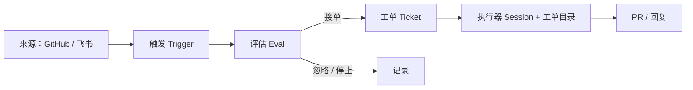

# SuperAgent 试验场

[SuperAgent](https://github.com/deepseek-ai/dsh-superagent-prototype)（`dsh-superagent`）是运行在 [DeepSeek Harness](https://www.deepseek.com/en/harness/) 上的主动式编码智能体，按单个 GitHub 仓库部署。它监听 GitHub（可选飞书）上的请求，把请求变成工单，在独立的会话和目录里完成调研、实现与验证，最后回到原对话交付结果，例如一个可评审的 Pull Request。

本仓库是 SuperAgent 的试验场，用来体验、演示和验证它的工作方式。

## 核心理念

**用尽量少的人类注意力，换尽量多的价值。**

- 只在被明确请求，或有团队写下的规则允许时才动手；
- 只在需要人做决定、或结果可供使用时才说话；
- 一次只问一个具体问题；需要人判断的改动就停下，不硬做。

## 主要功能

### 接入 GitHub 与飞书

- 监听 GitHub 通知、订阅的 Issue / Pull Request 与 CI 变化，以及 PR 的合并与关闭；可按需打开「接收全部」，处理仓库里所有新 Issue、PR、评论和默认分支 CI。
- 接入飞书群聊、私聊与话题，支持历史消息恢复和订阅话题轮询。
- 来源先按允许名单与准入表过滤：谁能发起明确请求、谁只能产生推断候选，都有明确规则；机器人最多产生推断候选，不能发起明确请求。

### 从请求到工单

- 需要新工作的消息进入评估：确定性的准入判断，加上模型结合上下文与仓库的研判。
- 评估决定接单、停止或忽略；接单时生成一张工单，记录授权范围、策略版本和请求强度（明确 / 推断）。
- 同一线程后续的消息会自动归入对应工单；需要时也可以由人在面板上重新评估。
- 无人要求的工作必须由团队规则授权，并且可以先以「只记录不执行」的模式观察效果。

### 独立的执行与交付

- 每张工单对应一个执行器会话和一个独立目录（通常用 `git worktree` 检出），工单之间互不干扰。
- 执行器自行阅读代码、实现改动、跑测试、跟踪 CI、回应评审意见，并把改动提交为 Pull Request。
- 并发受控；人的追问可以优先获得执行槽位，长任务转后台后仍可继续对话。
- 完成后在原始对话交付结果；未就绪时保持安静，受阻时说清楚缺什么。

### 订阅与持续跟进

- 工单会订阅来源线程（如 PR、Issue、飞书话题），后续讨论自动作为上下文送达，不需要再次 @ 机器人。
- 机器人和 CI 的消息只提供上下文，不能唤醒已被人工停止或已结束的工单。

### 管理面板

- 在 DeepSeek Harness Web 侧边栏打开 SuperAgent 面板，按「Overview / Source / Trigger / Eval / Execution / Settings」查看。
- 优先展示需要人处理的工作；健康状态不占空间。
- 可以追溯每个请求从触发、评估到工单的完整历史，并配置来源、策略、模型、并发与提示词。

## 工作流程

## 了解更多

- 原型仓库与设计文档：[deepseek-ai/dsh-superagent-prototype](https://github.com/deepseek-ai/dsh-superagent-prototype)
- 设计文章中文存档：[Super-agent 设计探索：迈向更自主的 Agent 系统](docs/super-agent-design.md)（英文原文：*Exploring Super-agent Design: Towards a More Autonomous Agent System*）
- 拆解文章：[拆解 SuperAgent：从「会话里的助手」到「持续在线的协作者」](docs/superagent-teardown.md)
- 实践记录：[从一句话需求到可评审的 PR](docs/superagent-practice.md)
- 调研报告：[AI4SE 企业落地调研报告：方法论、实践与效果数据](docs/ai4se-enterprise-adoption-report.md)
- 安装与配置：原型仓库中的 [SETUP.md](https://github.com/deepseek-ai/dsh-superagent-prototype/blob/main/SETUP.md)

## 说明

SuperAgent 目前是研究原型，不是 DeepSeek 官方产品。它可能仍有缺陷，工程实践也未必一致，使用前请自行评审与适配。
