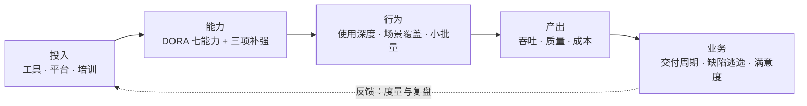
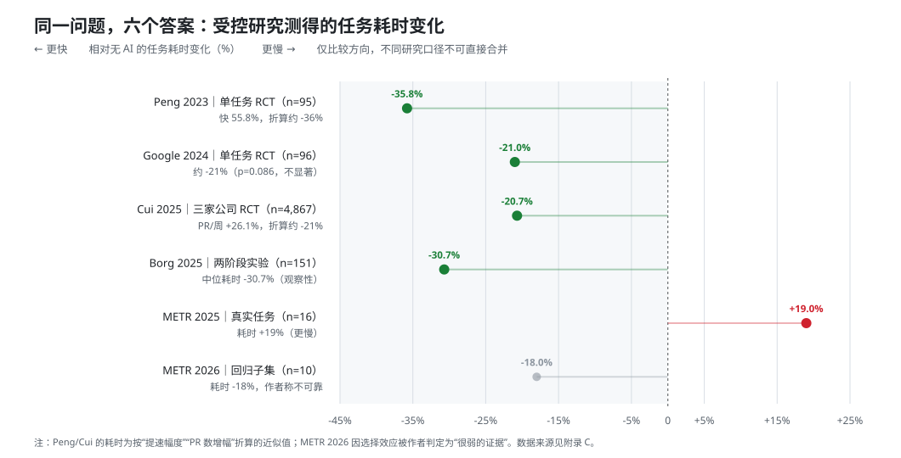
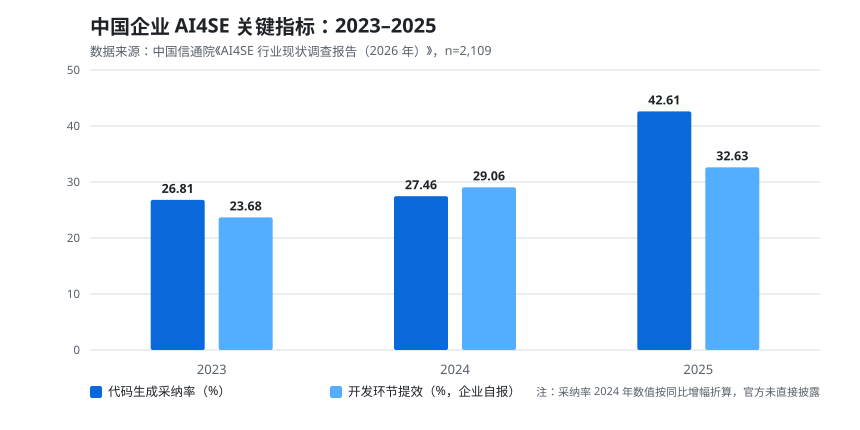

# AI4SE 企业落地调研报告

**副标题：方法论、落地实践与效果数据**

> **调研范围**：中大型企业软件研发组织（研发人员 50 人以上），覆盖需求、设计、编码、评审、测试、运维全生命周期。
> **资料截止**：2026 年 10 月。文中数据均标注来源编号，完整出处见[附录 C](#附录-c参考资料)。
> **版本**：Markdown 版（本文件）；Word 版见 [ai4se-enterprise-adoption-report.docx](ai4se-enterprise-adoption-report.docx)。
> **说明**：本报告由自动化 agent 基于公开资料整理，供决策参考。不同来源的统计口径差异很大，关键数字引用前请回到原始报告核对。

---

## 摘要

### 十个判断

**1. 「用不用」已经不是问题，问题是「用出了什么」。**
DORA 2025 调研显示，90% 的技术从业者已在工作中使用 AI；[2] Stack Overflow 2025 调研中，84% 的开发者正在使用或计划使用 AI 工具，专业开发者中 50.6% 每天使用。[5] 中国信通院 2026 年调研（有效样本 2109 份）显示，41.08% 的受访企业在研发中应用大模型已超过一年，开发人员渗透率超过 90% 的企业占比从 2024 年的 5.71% 跃升至 27.65%。[1] 采用率曲线已经走完陡峭段。

**2. 但收益高度分化，且集中在「内环」。**
企业自报数据相当乐观：开发环节提效 32.63%、运维 36.36%，代码生成采纳率 42.61%。[1] 受控研究给出的答案却从「快 55.8%」到「慢 19%」不等。[7][6] 差距不在谁在撒谎，而在测的不是同一件事——单任务速度、每周合并请求数、端到端交付周期，是三套不同的账。

**3. 决定成败的是组织系统，不是模型。**
DORA 2025 的核心结论是：AI 是**放大器**——它放大高绩效组织的优势，也放大混乱组织的缺陷。有高质量内部平台、清晰 API、强测试实践的团队，AI 是强力协作者；工具碎片化、数据孤岛、基础设施脆弱的团队，AI 只是让他们更快地生产技术债。[2][4]

**4. 「验证税」是 AI4SE 的第一成本项。**
30% 的开发者对 AI 生成代码的信任度「很低或没有」。[2] 写代码省下的时间，被审计、返工、评审重新占用。作者端的提效会直接转化为评审者的认知负荷——「审查别人写的代码比写代码难得多，而 AI 正在提高产生待审代码的速度」。[4]

**5. 质量与安全风险可以量化，且不小。**
Veracode 对 100 多个模型、80 个编码任务的测试显示：在安全实现与不安全实现之间，模型有 45% 的概率选择不安全的那一个；Java 风险最高，跨站脚本（XSS）威胁漏检率达 86%。[10] DORA 同时发现，AI 采用率更高的团队，交付吞吐**和**交付不稳定度同时上升。[2]

**6. 行业整体处在 L2 到 L3 的迁移期。**
信通院成熟度模型中，处于 L3「核心智能化」的企业占比从 17.62% 升至 29.75%；运维侧 76.82% 的企业仍在 L2/L3。[1] 真正规模化的是「辅助」，不是「自主」。把 L4/L5 的能力当作 2026 年的采购标准，是典型的预期错配。

**7. 效果最确定的三个场景：代码补全、测试用例生成、运维问答。**
代码生成采纳率 42.61%、入库采纳率 40.67%；文本测试用例平均采纳率 43.26%；运维环节提效超过 30% 的企业占 74.24%。[1] 共同特征是：高频、输入输出边界清楚、结果可快速验证。

**8. 端到端 ROI 取决于流程改造，而非工具数量。**
小批量提交、AI 前置评审、测试左移是三个已被验证的杠杆。若不改造，生成越快、评审越堵，吞吐增益会被在制品（WIP）吞掉。

**9. 治理必须前置。**
代码版权、数据分级、模型准入、安全门禁、影子 AI，这五件事要在规模化推广**之前**定好。事后补治理的代价，通常是一次安全事件或一次合规审计。

**10. 2026–2027 的分水岭：从「工具采购」转向「工程系统改造 + 度量体系」。**
信通院调研中，把「智能开发」列为 2026 年重点方向的企业超过 30%；[1] Gartner 预测到 2028 年 90% 的企业软件工程师会使用 AI 代码助手（2024 年初不足 14%）。[12] 工具会变成默认配置，差异将来自组织能力。

### 关键数字速览

| 指标 | 数值 | 口径与来源 |
| --- | --- | --- |
| 技术从业者 AI 使用率 | 90% | DORA 2025 全球调研 [2] |
| 开发者使用或计划使用 AI | 84% | Stack Overflow 2025，n=33,662 [5] |
| 企业研发应用大模型超过一年 | 41.08% | 信通院 2026，n=2,109 [1] |
| 开发人员渗透率 >90% 的企业 | 27.65%（2024：5.71%） | 信通院 2026 [1] |
| 代码生成采纳率 | 42.61% | 信通院 2026 [1] |
| 代码入库采纳率 | 40.67% | 信通院 2026 [1] |
| 开发环节提效 | 32.63%（2024：29.06%） | 企业自报，信通院 2026 [1] |
| 测试用例采纳率 | 43.26% | 信通院 2026 [1] |
| 运维环节提效 >30% 的企业 | 74.24% | 信通院 2026 [1] |
| 受控实验最大增益 | 任务快 55.8% | Peng et al. 2023，n=95 [7] |
| 受控实验最大负向 | 任务慢 19% | METR 2025，n=16 [6] |
| AI 生成代码含安全问题 | 45% | Veracode 2025，100+ 模型 [10] |
| GenAI 试点无财务回报 | 95% | MIT NANDA 2025，150 位高管 [11] |
| 2028 年使用 AI 代码助手的工程师 | 90% | Gartner 预测 [12] |

---

## 1. 定义与坐标系

### 1.1 AI4SE 是什么

**AI4SE（AI for Software Engineering，智能化软件工程）**，指把大模型、智能体等技术系统性地嵌入软件工程全生命周期，使需求、设计、编码、评审、测试、运维各环节获得生成、理解、推理与执行能力，并由此改变研发流程、组织分工与交付方式。

中国信通院在《AI4SE 行业现状调查报告（2026 年）》中的表述是：大模型、智能体等技术「正深度融入需求分析、架构设计、编码实现、测试验证、运维管控等全生命周期环节」。[1]

本书给出一个更可操作的**三层定义**，后文的方法论与实践都挂在这三层上：

| 层次 | 名称 | 特征 | 典型形态 | 价值兑现周期 |
| --- | --- | --- | --- | --- |
| T1 | 工具层（AI-assisted） | 人在原有流程里用 AI 加速单点任务 | IDE 补全、Chat 问答、单测生成 | 数周 |
| T2 | 流程层（AI-augmented） | AI 进入流程，改变交接物、节奏与角色 | AI 评审、需求转用例、Agent 修缺陷 | 1–2 个季度 |
| T3 | 组织层（AI-native） | Agent 成为研发主体之一，流程产物为 Agent 而设计 | 多 Agent 协同、规约驱动开发、OPC 团队 | 1–3 年 |

三层不是替代关系，而是叠加关系。多数企业 2026 年的真实位置是「T1 普及、T2 试点、T3 探索」。信通院调研中「流程产物需要被重新设计为 AI 友好型、第一读者从人变成 Agent」的判断，描述的正是 T3 的形态。[1]

### 1.2 从 SE 1.0 到 SE 3.0

理解 AI4SE 的位置，需要把它放回软件工程自身的演化序列：

| 阶段 | 核心生产力 | 组织形态 | 主要度量 | 瓶颈 |
| --- | --- | --- | --- | --- |
| SE 1.0 手工作坊 | 个人技能 | 小团队、师徒制 | 功能是否可用 | 人的产能 |
| SE 2.0 工程化 / DevOps | 流程与自动化 | 职能分工、平台团队 | DORA 四指标、缺陷率 | 协作摩擦、交付管道 |
| SE 3.0 智能化（AI4SE） | 模型与 Agent | 人机编队、Agent 运维 | 采纳率 + 存活率 + 端到端价值 | 验证能力、上下文质量、治理 |

这条演化线解释了一个常见困惑：为什么买了最好的模型，效率却没有质变？因为 SE 2.0 的瓶颈（协作摩擦）没有被解决，AI 只是把摩擦点从「写」转移到了「审」。

### 1.3 AI4SE 不等于「AI 写代码」

编码只是研发链条中的一环。按环节拆开，AI 的角色与成熟度差异很大：

| 环节 | AI 的典型角色 | 成熟度 | 可验证性 | 2026 年企业实践强度 |
| --- | --- | --- | --- | --- |
| 需求 | 需求分析、补全、评审、转用例 | 中 | 弱（对错难判定） | 中（分析+生成合计 39.75%）[1] |
| 设计 | 方案生成、接口/数据库设计、ADR | 中 | 中 | 中（五环节合计 >90%）[1] |
| 编码 | 补全、生成、重构、修复 | 高 | 强（能编译能跑） | 高（采纳率 42.61%）[1] |
| 评审 | 缺陷检测、规范检查、摘要 | 中 | 中 | 上升期 |
| 测试 | 用例/脚本/数据生成、结果分析 | 高 | 强 | 高（用例采纳率 43.26%）[1] |
| 运维 | 问答、巡检、告警分析、根因 | 中高 | 强（有监控数据） | 高（提效 >30% 占 74.24%）[1] |
| 知识/文档 | 检索、总结、生成 | 中 | 弱 | 中（RAG 部署占 40.35%）[1] |

一个被反复验证的规律：**可验证性越强的环节，AI 落地越快、效果越实**。代码能编译、测试能跑、告警能对账，所以这三个环节先兑现；需求和设计的「对错」要靠人来判断，收益就被推迟了。

### 1.4 四个常见误解

| 误解 | 现实 | 后果 |
| --- | --- | --- |
| 「买了工具就是落地了」 | 工具只是 T1；流程与组织不变，收益封顶在个人提效 | 续费时发现无法证明 ROI |
| 「生成量等于生产力」 | 代码行数、采纳行数都会因 AI 膨胀；要看合入后 30/90 天存活率与返工率 | 指标好看，交付没变快 |
| 「目标是替代人」 | 2026 年的现实是「人机编队」：人负责意图、边界与验收 | 抵触情绪、影子使用、人才流失 |
| 「一次性项目」 | 模型能力每 6–12 个月跃迁一次，流程与治理需持续演进 | 上线即过时 |

---

## 2. 方法论：从工具引入到系统改造

### 2.1 第一性判断：AI 是放大器

DORA 2025 报告用一个词概括了 AI 对软件交付的作用：**放大器（amplifier）**。

> AI 的主要作用是放大器。它放大高绩效组织的优势，也放大挣扎中组织的缺陷。如果组织有高质量的内部平台、清晰的 API、顺畅的工作流和扎实的测试实践，AI 就是强力协作者；如果团队面临工具碎片化、数据孤岛或脆弱的基础设施，AI 只会帮他们更快地产生技术债。[2][4]

这个判断有三个直接推论，构成后文所有方法论的出发点：

1. **先修系统，再上 AI；至少并行。** 内部平台、测试覆盖、CI 稳定性、API 目录，这些「AI 之前」的基础设施决定了 AI 的上限。
2. **不要用 AI 去绕过流程问题。** 用 AI 生成更多代码去弥补评审积压，只会让积压更快增长。
3. **度量要跟着系统走。** 单点采纳率不能代表组织产出；必须同时看交付吞吐、稳定性和开发者体验。

### 2.2 能力框架：DORA 七项能力 + 中国企业补强

DORA 在 2025 年报告中识别出七项**放大 AI 收益**的组织能力，构成了一套可以直接照做的能力清单：[3]

| # | 能力 | 含义 | 可操作动作 | 度量信号 |
| --- | --- | --- | --- | --- |
| 1 | 清晰且已传达的 AI 立场 | 组织明确「允许用什么、禁止用什么、期望怎么用」 | 发布 AI 使用政策、强制/选修培训、内部案例库 | 政策知晓率、培训覆盖率 |
| 2 | 健康的数据生态 | 内部数据可发现、可访问、质量可信 | 数据目录、指标口径统一、数据 Owner 制 | 找数时长、数据质量投诉率 |
| 3 | AI 可访问的内部数据 | 模型能读到代码库、文档、工单等私有上下文 | 代码索引、RAG 知识库、MCP 工具接入 | 上下文命中率、检索满意度 |
| 4 | 强版本控制实践 | 代码、配置、提示词、流水线全部纳管 | 提示词入库、IaC、提交粒度治理 | 纳管资产比例、回滚可用性 |
| 5 | 小批量工作 | 任务与变更足够小，便于验证与回滚 | 限制 PR 规模、拆分需求、缩短任务周期 | PR 中位行数、任务周期 |
| 6 | 用户中心 | 以用户价值而非产出量作为成功标准 | 需求验收标准前置、用户反馈闭环 | 需求交付价值、NPS |
| 7 | 高质量内部平台 | 平台抽象掉基础设施复杂度，自助可用 | 内部开发者平台（IDP）、黄金路径、自助环境 | 平台自助率、上手时长 |

**中国企业的三项补强。** 信通院调研揭示的挑战结构与 DORA 样本不同，需要额外补三块：[1]

| 补强项 | 数据依据 | 具体做法 |
| --- | --- | --- |
| 人才与培训 | 「专业人才短缺」以 34.02% 居首 | 分层培训（管理者/骨干/全员）、AI Champion、认证与激励 |
| 成本与 ROI | 「投入成本高、短期 ROI 不明确」升至 26.85% | 先算基线再推广、按场景核算单位成本、设置退出机制 |
| 知识与数据资产 | 私有化部署中 RAG 占 40.35%，为最高 | 领域术语库、代码规范库、历史缺陷库、可检索的架构文档 |

七项能力加上三项补强，构成一个十项的能力清单。落地时不必全做，但**至少前六项要有明确 Owner**，否则规模化阶段一定卡住。

### 2.3 成熟度模型：L1 到 L5

把能力清单落到时间轴上，就是成熟度模型。信通院用 L1–L5 划分企业软件研发智能化水平，2025 年处于 L3「核心智能化」的企业占比从 17.62% 升至 29.75%，处于 L2 及以下的比例下降 15.9 个百分点。[1]

| 级别 | 名称 | 特征 | 典型场景 | 组织形态 | 度量重点 |
| --- | --- | --- | --- | --- | --- |
| L1 | 探索 | 个别开发者自费或试用 | 补全、问答 | 无组织动作 | 使用人数 |
| L2 | 部分智能化 | 单点工具在部分团队铺开 | IDE 补全、单测生成 | 工具管理员 | 采纳率、满意度 |
| L3 | 核心智能化 | AI 进入核心研发环节，跨环节开始贯通 | Agent 修缺陷、AI 评审、需求转用例 | 平台团队 + AI Champion | 入库采纳率、返工率、评审周期 |
| L4 | 高度智能化 | 多环节端到端自动化，人做编排与验收 | 需求→代码→测试→上线半自动 | 人机编队、Agent 运维 | 端到端周期、变更失败率 |
| L5 | 自主化 | Agent 自主规划并闭环交付，人只在关键节点监督 | 长时任务、多 Agent 协同 | OPC / 极小团队 | 单位交付成本、自治任务成功率 |

三条使用建议：

- **不要跳级。** L2 的工具铺开没有配套度量，直接上 L4 的端到端自动化，结果是「自动化地生产不可信代码」。
- **L3 的标志是「贯通」而不是「单点最强」。** 需求→用例→代码→测试的链路能带着上下文走完，才算 L3。
- **每一级都要有退出条件。** 例如从 L2 升 L3 的退出条件可以是：入库采纳率 ≥ 35%、AI 代码 30 天存活率 ≥ 90%、评审等待时间不升反降。

### 2.4 场景分层：内环、外环、组织层

同样的模型能力，放在不同场景里 ROI 差一个数量级。按「离代码的距离」分层，是排优先级最有效的方法：

| 层 | 场景 | AI 的角色 | 收益兑现周期 | 主要风险 | 建议优先级 |
| --- | --- | --- | --- | --- | --- |
| 内环 | 补全、单测、重构、解释代码 | 高速起草者 | 2–6 周 | 低质代码、幻觉 API | ★★★★★ |
| 内环 | CLI Agent 改多文件、修缺陷 | 执行者 | 1–2 月 | 大 diff、难评审 | ★★★★ |
| 外环 | 需求分析、方案设计、评审 | 认知协作者 | 1–2 季度 | 幻觉需求、责任模糊 | ★★★ |
| 外环 | 测试设计、用例生成、结果分析 | 生成 + 判别 | 1 季度 | 弱断言、覆盖幻觉 | ★★★★ |
| 外环 | 运维问答、巡检、告警分析 | 检索 + 推理 | 1 季度 | 误操作、根因幻觉 | ★★★★ |
| 组织 | 知识库、研发规范、度量 | 基础设施 | 2–4 季度 | 知识陈旧、口径不一 | ★★★ |
| 组织 | 多 Agent 协同、规约驱动开发 | 研发主体之一 | 1–3 年 | 治理空白、技能断层 | ★★ |

**排序原则：高频 × 低风险 × 可验证。** 三个条件同时满足的场景先做；缺一个就降级为试点；缺两个就先别做。

### 2.5 工具形态选型

2026 年的工具市场已经分化出四种形态，它们不是替代关系，而是按任务复杂度分层：

| 形态 | 交互方式 | 适用任务 | 上下文获取 | 验证成本 | 治理要求 | 代表形态 |
| --- | --- | --- | --- | --- | --- | --- |
| IDE 助手 | 行内补全 / 侧栏对话 | 单文件、样板、补全 | 当前文件 + 少量检索 | 低 | 低 | Copilot、通义灵码、CodeBuddy |
| Chat 问答 | 会话 | 解释、方案、报错分析 | 手动粘贴 | 中 | 中 | 通用大模型网页/API |
| CLI Agent | 终端任务 | 多文件修改、跑测试、修缺陷 | 仓库索引 + 工具调用 | 中高 | 中高 | Claude Code、Codex CLI、Gemini CLI |
| 自治 PR Agent | 派发任务 → 产出 PR | 独立小需求、批量修复 | 全仓库 + 工单 + CI | 高 | 高 | 编码 Agent 平台 |

选型的三个经验判断：

1. **形态要匹配任务的「验证成本」。** 验证成本低的（补全、单测）可以放手；验证成本高的（跨服务重构、数据库迁移）必须有人工门禁。
2. **上下文能力比模型分数更重要。** 同一个模型，接入仓库索引与规范文件后，采纳率通常显著高于裸聊。
3. **国内工具已成主力。** 信通院调研中，国内智能开发工具占比 60.56%，海外 39.44%；形态上 AI IDE 占 34.31%、CLI 占 12.55%。[1] 选型时需同时评估合规与生态适配。

### 2.6 度量体系：三层指标 + 三条反偏差规则

**第一层：交付层（DORA 四指标）**——部署频率、变更前置时间、变更失败率、服务恢复时长。它们衡量的是「组织交付能力」，不受工具营销影响。补充一个「交付不稳定度」指标，因为 DORA 发现 AI 采用率与不稳定度正相关。[2]

**第二层：开发者层（SPACE）**——满意度、绩效、活动、沟通协作、效率与流。AI 时代尤其要关注「效率与流」中的中断次数和「沟通协作」中的评审负担。

**第三层：AI 专属指标**——这是最容易被做假的一层，必须定义清楚：

| 指标 | 定义 | 采集方式 | 健康参考 | 常见误用 |
| --- | --- | --- | --- | --- |
| 生成采纳率 | 采纳的生成行 / 生成行 | IDE 埋点 | 35%–50% | 拿它当生产力 |
| 入库采纳率 | 合入主干的生成行 / 生成行 | 代码托管平台 | 30%–45% | 忽略返工 |
| 30/90 天存活率 | 生成代码在 N 天后仍存在且未被重写的比例 | 代码演化分析 | ≥85% / ≥75% | 不做归因 |
| 返工率 | 因 AI 代码缺陷产生的修复工单占比 | 缺陷库标签 | <10% | 标签缺失 |
| 评审等待时长 | PR 创建到首次人工评审的时长 | 平台数据 | 不高于基线 | 只看平均值 |
| 单 PR 规模 | 变更行数中位数 | 平台数据 | ≤200 行 | 用总量考核 |
| 验证税 | 审查/返工耗时 / 生成节省耗时 | 埋点 + 抽样访谈 | <50% | 只靠自报 |
| 单位成本 | 工具 + 算力 + 培训 / 有效产出 | 财务口径 | 逐季下降 | 漏算人力 |

**三条反偏差规则：**

1. **用对照，不用感觉。** METR 的研究中，开发者事前预计 AI 能省 24% 时间，事后自评省了 20%，而实测是**多花 19%**。[6] 自报数据系统性偏乐观。
2. **用行为埋点，不用问卷。** 采纳率、存活率、返工率都来自系统日志；问卷只用于满意度与障碍诊断。
3. **看留存与返工，不看生成量。** 生成量会随模型变强而膨胀，留存率才反映真实价值。

### 2.7 治理与合规：五条红线

| 维度 | 红线 | 落地机制 |
| --- | --- | --- |
| 数据 | 客户数据、密钥、生产数据不得进入未授权模型 | 数据分级、DLP、模型白名单、脱敏网关 |
| 代码 | 生成代码需过许可证与依赖扫描 | SCA/许可证扫描进 CI、生成物标记 |
| 安全 | 高风险系统（支付、权限、加密）AI 代码必须人工复核 | 分级门禁、双人评审、灰度和回滚 |
| 合规 | 满足监管对模型备案、可解释、可审计的要求 | 提示词与上下文留痕、模型版本管理 |
| 组织 | 禁止影子 AI（未报备的第三方工具） | 统一入口、网络管控、例外审批 |

合规基线可参照三类文件：国内《生成式人工智能服务管理暂行办法》、欧盟《人工智能法案》（通用目的 AI 义务自 2025 年 8 月起适用）、ISO/IEC 42001 人工智能管理体系。[15][16][17] 金融、医疗等强监管行业还需叠加行业监管要求。

### 2.8 方法论小结：一条因果链



这条链上有三个容易断的环节，也是咨询项目最常见的失败点：

- **A→B 断**：只买工具，不建平台、不培训，能力没长出来。
- **B→C 断**：能力有了，但没有场景清单和激励，使用深度上不去。
- **C→D 断**：用得多，但流程没改（大 PR、慢评审），产出被在制品吞掉。

下一章把这条链拆成可执行的路线图与分环节实践。

---

## 3. 落地实践：从试点到规模化

### 3.1 五阶段路线图

| 阶段 | 周期 | 目标 | 关键动作 | 交付物 | 退出条件 | 失败信号 |
| --- | --- | --- | --- | --- | --- | --- |
| 0 准备 | 2–4 周 | 建立基线，明确边界 | 采集 DORA 四指标、选 1–2 个试点团队、发布 AI 使用政策 | 基线报告、政策文件、试点名单 | 基线数据可用、政策已宣贯 | 无法拿到基线，或政策含糊 |
| 1 试点 | 4–8 周 | 验证单场景价值 | 单一工具、单一场景、对照组、每周复盘 | 试点报告（含对照数据） | 采纳率 ≥30%，评审时长不升 | 只报满意度，无对照 |
| 2 扩展 | 1–2 季度 | 从团队到部门 | 平台化接入、分层培训、场景清单扩充 | 平台能力、培训体系、场景库 | 三个以上团队复用，指标可横向比 | 每个团队各自采购 |
| 3 制度化 | 2–4 季度 | 嵌入流程与考核 | 小批量强制、AI 评审前置、入库采纳率进考核 | 流程规范、考核办法 | 指标进入季度经营会 | 考核只看生成量 |
| 4 优化 | 持续 | 提质增效与淘汰 | 场景 ROI 复盘、模型与工具汰换、Agent 接入 | 年度 ROI 报告 | 单场景 ROI 可核算 | 场景只增不减 |

一个常被忽略的细节：**阶段 0 的基线必须包括「评审等待时间」和「PR 中位行数」**。这两个数字决定了 AI 带来的增量是转化为交付，还是转化为积压。

### 3.2 分环节实践地图

#### 3.2.1 需求与设计

**做法。** 用领域术语库和产品文档做检索增强，让模型完成需求补全、歧义检测、验收标准生成、需求转用例。设计环节用于方案对比、接口草案、数据库表设计初稿，以及架构决策记录（ADR）的起草。

**数据。** 信通院调研中，需求环节 AI 应用集中在「需求分析」与「需求生成与优化」两个环节，合计占 39.75%；设计环节在需求拆解、详细设计、架构设计、接口设计、数据库设计五个环节的合计应用占比超过 90%。[1]

**坑与对策。**

| 坑 | 表现 | 对策 |
| --- | --- | --- |
| 幻觉需求 | 模型补出业务上不存在的规则 | 每条生成需求必须能追溯到原始来源 |
| 术语漂移 | 同一概念多种叫法 | 领域术语表作为强制上下文 |
| 责任模糊 | 「AI 说这样设计」 | ADR 必须由人签署，记录否决理由 |

#### 3.2.2 编码

**做法。** 分两档：日常用 IDE 补全与局部生成；复杂任务用 CLI Agent 或 PR Agent，配合仓库索引、规范文件（如 `AGENTS.md`、`CLAUDE.md`）、可运行的测试与 CI。

**数据。** 代码生成采纳率 42.61%（同比 +55.17%），入库采纳率 40.67%（同比 +74.32%）；提效超过 30% 的企业接近七成，超过 40% 的接近四成（同比 +65.8%）。[1] 采纳率的提升幅度大于入库采纳率，说明「生成得好」与「合得进去」之间仍有损耗。

**坑与对策。**

| 坑 | 表现 | 对策 |
| --- | --- | --- |
| 大 diff | 一次生成上千行，评审无法进行 | 限制单次任务范围，PR ≤200 行 |
| 重复代码 | 复制粘贴式实现，重复率上升 | 生成前先检索既有实现，加重复检测门禁 |
| 幻觉 API | 调用不存在的接口或参数 | 以内部 API 目录为上下文，编译与单测兜底 |
| 隐性技术债 | 能跑但难维护 | 30/90 天存活率纳入度量 |

#### 3.2.3 代码评审

**做法。** 把 AI 评审前移到作者端（提交前自检），而不是给评审者再加一个 AI 工具；同时强制小批量、设置评审 SLA、用摘要降低理解成本。

**为什么重要。** DORA 明确指出：作者端的提效会转化为评审者的认知负荷，「审查别人的代码比写代码难得多，而 AI 正在提高产生待审代码的速度」。[4] 如果评审流程不变，AI 生成的代码越多，评审队列越长。

**度量。** 首次评审等待时长、评审轮次、单 PR 行数、评审意见密度。健康状态是：评审等待时长不升，评审轮次不增。

#### 3.2.4 测试

**做法。** 用例生成（正向 + 边界 + 异常）、测试脚本生成、测试数据构造、失败日志分析。优先落在功能测试与接口测试。

**数据。** 功能与接口测试合计占智能测试落地的 50% 以上；测试设计类场景（用例、方案、测试点、脚本生成）合计 53.81%；文本用例平均采纳率 43.26%；测试提效超过 30% 的企业占 66.23%（2024 年 56.14%）。[1]

**坑与对策。**

| 坑 | 表现 | 对策 |
| --- | --- | --- |
| 弱断言 | 用例能跑但测不出问题 | 断言由人评审，覆盖率作为门禁 |
| 覆盖幻觉 | 声称覆盖了未覆盖的分支 | 以真实覆盖率报告为准 |
| 用例膨胀 | 生成大量重复用例 | 去重 + 按风险分层维护 |

#### 3.2.5 运维

**做法。** 运维问答（知识库 + 工单历史）、智能巡检、告警聚合与根因分析、变更风险提示。

**数据。** 运维问答占智能运维落地场景的 22%，智能巡检约 19%，告警分析约 15%；提效超过 30% 的企业占 74.24%（2024 年 45.48%），提效超过 60% 的企业占 21.21%（2024 年 11.38%）。[1] 运维是 2025 年提效跃升最明显的环节（28.67% → 36.36%）。

**坑与对策。**

| 坑 | 表现 | 对策 |
| --- | --- | --- |
| 越权操作 | Agent 直接执行变更 | 只读优先，写操作走审批与灰度 |
| 根因幻觉 | 给出看似合理但错误的结论 | 结论必须附证据链（日志、指标） |
| 知识陈旧 | 回答基于过期的 Runbook | 知识库版本化，定期回收 |

#### 3.2.6 文档与知识

**做法。** 代码解释、接口文档生成、故障复盘草稿、内部知识问答。RAG 是企业私有化部署中最主流的形态（占 40.35%）。[1]

**关键判断。** 知识库的质量决定上限。把 Wiki 直接灌进向量库，得到的是「会引用过期文档的助手」。有效做法是：文档 Owner 制、有效期字段、按代码版本对齐。

#### 3.2.7 平台与上下文工程

这是所有环节的公共底座，也是 2026 年投入产出比最高的一块：

- **仓库上下文**：代码索引、调用图、模块地图，让 Agent 知道「改这里会影响谁」。
- **规则文件**：把编码规范、目录约定、测试要求写进 `AGENTS.md` 等文件，随仓库版本管理。
- **工具接入**：通过 MCP 等协议把工单、CI、监控、内部 API 暴露给 Agent。
- **可运行性**：一条命令起环境、跑测试、看日志；否则 Agent 无法自我验证。
- **小批量流水线**：自动拆分、自动回滚、灰度发布。

### 3.3 组织机制

| 角色 | 职责 | 配置建议 |
| --- | --- | --- |
| 发起人（Sponsor） | 定目标、给预算、承担结果 | 研发负责人或 CTO |
| 平台团队 | 工具接入、上下文工程、度量埋点 | 3–8 人，独立于业务团队 |
| AI Champion | 团队内的布道者、首批试点者、问题反馈 | 每个 20–30 人团队 1 名 |
| 度量小组 | 基线与季度复盘、ROI 核算 | 可由 PMO 兼任 |
| 安全合规 | 政策、评审、事件响应 | 与现有安全团队合并 |

四个有效机制：

1. **双周 Demo**：展示真实场景与失败案例，比培训更能推动使用。
2. **失败复盘**：把 AI 引入的缺陷做成案例库，比禁令有效。
3. **场景清单**：明确「推荐用 / 谨慎用 / 禁止用」三类场景，降低一线决策成本。
4. **激励对齐**：奖励「合入后存活的高质量产出」，不奖励生成量。

信通院把「专业人才短缺」列为第一挑战（34.02%），意味着培训不是福利，而是基础设施。[1]

### 3.4 四个案例

#### 案例一：Google——用组织研究指导工具落地

**背景。** Google 既是 AI 编码工具的重度使用者，也是 DORA 研究的发起方，其内部数据是理解「规模化之后会发生什么」的最好样本。

**做法与数据。**

- 2024 年 10 月，皮查伊在财报电话会上表示，谷歌超过四分之一的新代码由 AI 生成。[14]
- DORA 2025 调研显示 90% 的技术从业者使用 AI，超过 80% 认为提升了生产力，但 30% 对 AI 生成代码的信任度很低或没有。[2]
- 对 1,110 条 Google 工程师开放回答的质性分析发现：AI 在十类场景中都提升了速度，但同时在十类场景中都带来了验证开销、幻觉与知识局限。[4]

**可复制点。** 把「员工体验研究」当成工具治理的一部分：不是问「好不好用」，而是问「时间省在哪里、又花在哪里」。

**局限。** Google 的内部平台与代码索引能力处于全球前列，其收益不能直接外推到平台能力一般的组织。

#### 案例二：ANZ Bank——受控实验 + 规模化推广

**背景。** ANZ 拥有 5,000 多名工程师，覆盖完整 SDLC。

**做法。** 六周实验（两周准备 + 四周测试）：第一阶段按提议场景使用并定期收集反馈；第二阶段分为对照组与 Copilot 组，完成相同的 Python 任务；随后在约 1,000 名工程师中推广，并跟踪早期数据。[8]

**结果。** 生产力与代码质量有显著提升，参与者反馈整体积极；对代码安全的影响「尚无定论」；1,000 人规模的早期数据表明生产力与工作满意度均有提升。[8]

**可复制点。** 「小组对照 + 大规模推广 + 持续跟踪」的三段式设计，是金融企业最稳妥的路径。

**局限。** 任务以受控练习为主，结论对真实业务任务的迁移性需打折。

#### 案例三：民生银行——流程与治理先行的规模化

**背景。** 银行研发「高标准、低容错」，对安全、效率、可控同时有要求。

**做法。** 以「慧码」旅程为指导方法，建设 AI4SE 服务支撑体系（技术知识运营、质量管控辅助、研发高效辅助、技术理解分析四大能力），并配置软件工程大模型应用的闭环管控策略；按「非关键类系统优先」的策略推广。[9]

**结果。** 研发辅助工具覆盖超过 1,600 名自主研发人员，生成采纳率 29%，AI 代码产量占比约 15%；智能分析工具把规范审查、诊断分析从小时级降到分钟级。[9]

**可复制点。** 「非关键系统先行 + 闭环管控 + 明确采纳率目标」，是把合规约束转化为落地路径的样本。

**局限。** 采纳率（29%）低于行业均值（42.61%），反映的是金融行业更严格的准入，而非工具能力差距。

#### 反例：METR——自报提效的可靠性边界

**设计。** 16 名资深开源开发者，在自有仓库的真实任务上随机分配「允许用 AI / 禁止用 AI」，共 246 个任务。[6]

**结果。** 使用 AI 的任务平均**多花 19%** 时间（置信区间 +2% 到 +39%）。而开发者事前预计能省 24%，事后自评省了 20%。[6]

**为什么重要。** 这不是说 AI 没用，而是说：**在开发者已经非常熟悉的成熟代码库中，AI 的边际价值可能为负**，而人的主观感受无法察觉这一点。它直接支持了 2.6 节的三条反偏差规则。

**2026 年更新。** METR 的后续实验因选择效应（大量开发者拒绝在无 AI 条件下参与）而无法给出可靠估计，作者判断「开发者现在可能确实更快了」，但自己的数据只能作为「很弱的证据」。[6]

### 3.5 八种失败模式

| # | 模式 | 症状 | 根因 | 对策 | 早期信号 |
| --- | --- | --- | --- | --- | --- |
| 1 | 工具堆叠 | 同时采购 5+ 工具，使用率都低 | 没有场景清单 | 收敛到 1–2 个主工具 + 1 个 Agent | 许可证利用率 <30% |
| 2 | 无基线 | 说不清提升了多少 | 阶段 0 缺失 | 补基线，先测后改 | 汇报只有满意度 |
| 3 | 只度量生成量 | 采纳行数上升，交付没变快 | 指标错位 | 改为入库采纳率 + 存活率 | 评审队列变长 |
| 4 | 评审瓶颈 | PR 等待时间翻倍 | 流程未改 | 小批量 + AI 前置评审 | 评审 SLA 频繁超时 |
| 5 | 影子 AI | 员工私下用未授权工具 | 政策缺位或过严 | 白名单 + 统一入口 + 例外审批 | 出现代码泄露投诉 |
| 6 | 技能退化 | 新人能交付但讲不清原理 | 跳过「有效挣扎」 | 关键模块禁止 AI 代写、结对与讲解 | 故障定位能力下降 |
| 7 | 数据不可达 | Agent 答非所问 | 代码/文档未索引 | 上下文工程专项 | 回答引用过期文档 |
| 8 | 治理缺位 | 上线后才发现合规问题 | 治理后置 | 政策、门禁、审计三件套前置 | 安全评审被卡 |

---

## 4. 效果数据：证据、区间与解释

### 4.1 先分级，再引用

同一个「提效 30%」，可能来自随机对照实验，也可能来自供应商白皮书。引用前必须先分级：

| 级别 | 证据类型 | 代表 | 能回答的问题 | 不能回答的问题 |
| --- | --- | --- | --- | --- |
| A | 随机对照 / 准实验 | Peng 2023、Paradis 2024、Cui 2025、METR 2025 | 因果方向与效应量 | 组织级 ROI |
| B | 大样本调查 | DORA 2025、Stack Overflow 2025、信通院 2026 | 分布、趋势、相关性 | 单团队因果 |
| C | 企业自报案例 | ANZ、民生银行 | 可行性与实施路径 | 可复制的效应量 |
| D | 厂商材料 / 媒体报道 | 各工具官网 | 线索 | 独立验证 |

**使用规则**：A 看方向，B 看分布，C 看可行性，D 只做线索。跨级比较数字（例如用 A 级的 55.8% 去论证组织级 ROI）是最常见的错误。

### 4.2 数据总表

| # | 来源 | 年份 | 样本 / 范围 | 指标 | 数值 | 级别 |
| --- | --- | --- | --- | --- | --- | --- |
| 1 | DORA [2] | 2025 | 全球技术从业者 | 工作中使用 AI 的比例 | 90% | B |
| 2 | DORA [2] | 2025 | 同上 | 认为 AI 提升生产力 | >80% | B |
| 3 | DORA [2] | 2025 | 同上 | 对 AI 代码信任「很低/没有」 | 30% | B |
| 4 | Stack Overflow [5] | 2025 | 33,662 名开发者 | 使用或计划使用 AI | 84% | B |
| 5 | Stack Overflow [5] | 2025 | 专业开发者 26,004 人 | 每天使用 AI | 50.6% | B |
| 6 | Stack Overflow [5] | 2025 | 全部受访者 | 对 AI 持正面态度 | 60%（2023/24 为 70%+） | B |
| 7 | 信通院 [1] | 2026 | 2,109 家企业 | 研发应用大模型超过一年 | 41.08% | B |
| 8 | 信通院 [1] | 2026 | 同上 | 开发人员渗透率 >90% 的企业 | 27.65%（2024：5.71%） | B |
| 9 | 信通院 [1] | 2026 | 同上 | 代码生成采纳率 | 42.61%（同比 +55.17%） | B |
| 10 | 信通院 [1] | 2026 | 同上 | 代码入库采纳率 | 40.67%（同比 +74.32%） | B |
| 11 | 信通院 [1] | 2026 | 同上 | 开发环节提效 | 32.63%（2024：29.06%） | B |
| 12 | 信通院 [1] | 2026 | 同上 | 运维环节提效 | 36.36%（2024：28.67%） | B |
| 13 | 信通院 [1] | 2026 | 同上 | 文本测试用例采纳率 | 43.26% | B |
| 14 | 信通院 [1] | 2026 | 同上 | 测试提效 >30% 的企业 | 66.23%（2024：56.14%） | B |
| 15 | 信通院 [1] | 2026 | 同上 | 运维提效 >30% 的企业 | 74.24%（2024：45.48%） | B |
| 16 | 信通院 [1] | 2026 | 同上 | 处于 L3「核心智能化」 | 29.75%（2024：17.62%） | B |
| 17 | Peng et al. [7] | 2023 | 95 名职业程序员 | 完成 HTTP 服务任务时间 | 快 55.8%（CI 21%–89%） | A |
| 18 | Paradis et al.（Google）[19] | 2024 | 96 名 Google 工程师 | 复杂企业任务耗时 | 约少 21%（p=0.086，不显著） | A |
| 19 | Cui et al. [18] | 2025 | 4,867 名开发者、3 家公司 | 每周完成 PR 数 | +26.08% | A |
| 20 | Borg et al. [18] | 2025 | 151 人（95% 职业开发者） | 任务时间中位数 | -30.7%（观察性）；可维护性无显著差异 | A |
| 21 | METR [6] | 2025 | 16 名资深 OSS 开发者、246 任务 | 任务耗时 | +19%（CI +2%–+39%） | A |
| 22 | METR [6] | 2026 | 10 名回归 + 47 名新开发者 | 任务耗时 | -18%（CI -38%–+9%）/ -4%；作者称不可靠 | A |
| 23 | ANZ [8] | 2024 | 5,000+ 工程师，1,000 人推广 | 生产力、质量、安全 | 生产力与质量正向；安全无定论 | C |
| 24 | 民生银行 [9] | 2025 | 1,600+ 研发人员 | 生成采纳率 / AI 代码占比 | 29% / 约 15% | C |
| 25 | Veracode [10] | 2025 | 100+ 模型、80 个任务 | 生成代码含安全缺陷 | 45% | A/B |
| 26 | MIT NANDA [11] | 2025 | 150 位高管、300 个部署 | 试点无 P&L 影响 | 95% | B/C |
| 27 | Gartner [12] | 2025 | 预测 | 2028 年使用 AI 代码助手的工程师 | 90%（2024 初 <14%） | D |
| 28 | Google [14] | 2024 | 公司口径 | 新代码中 AI 生成占比 | >25% | C |

### 4.3 六项受控研究：同一问题，六个答案



*图 1　六项受控研究测得的任务耗时变化（负值 = 更快；数据来源见附录 C）*

上图把「任务耗时变化」放在同一坐标上（负值 = 更快）。可以看出三个结构性规律：

**规律一：任务越「标准化」，增益越大。** Peng 的 HTTP 服务任务是近乎理想的场景（有明确规格、通用知识），增益 55.8%；METR 的任务是开发者在维护了五年的自有仓库中做真实工作，增益为负。

**规律二：经验越浅，增益越大。** Cui 与 Peng 都发现，经验较少的开发者采纳更多、收益更大；METR 研究的是另一端——成熟项目里的专家。

**规律三：Agent 时代让测量本身变难。** METR 2026 年的实验因「大量开发者拒绝在无 AI 条件下参与」而失效，作者承认数据只能作为很弱的证据。[6] 这意味着 2026 年之后，「干净的对照」会越来越难做，企业应尽早建立自己的基线。

### 4.4 企业侧数据：分布比均值更有意义



*图 2　中国企业的代码采纳率与开发环节提效（数据来源：信通院 [1]）*

信通院连续三年的数据给出了一条清晰的曲线：代码采纳率从 2023 年的 26.81% 升至 2025 年的 42.61%，开发环节提效从 23.68% 升至 32.63%。[1] 但均值掩盖了分化：

- **头部**：提效超过 40% 的企业接近四成，渗透率超过 90% 的企业占 27.65%。
- **尾部**：仍有半数企业应用大模型不足一年，处于 L2 及以下。
- **结构**：运维提效（36.36%）反超开发（32.63%），说明「可验证性强 + 知识密集」的场景正在后来居上。

### 4.5 质量与安全：被低估的成本项

| 维度 | 证据 | 数值 | 含义 |
| --- | --- | --- | --- |
| 安全 | Veracode 2025 [10] | 45% 的生成结果选择不安全实现；XSS 漏检 86%；Java 风险最高 | 安全门禁不能省 |
| 稳定性 | DORA 2025 [2] | AI 采用率越高，吞吐与不稳定度同时上升 | 需要更强的回滚与灰度 |
| 可维护性 | Borg et al. [18] | 后续演化 AI 代码的开发者并不更慢，可维护性无显著差异 | 与「AI 代码必然劣化」的直觉相反 |
| 重复代码 | GitClear [13] | 长期数据显示复制粘贴型变更占比上升 | 需重复率门禁（该结论未经独立复现） |
| 评审负担 | DORA [4] | 作者端提效转化为评审端负荷 | 评审流程必须同步改造 |

值得注意的是，Borg 的结论与 GitClear 的方向相反：一个说可维护性无显著差异，一个说重复代码在上升。合理的解释是**测量对象不同**——前者测「同一任务的后续演化成本」，后者测「代码库层面的结构变化」，且时间窗更长。这正说明质量结论必须看口径。

### 4.6 为什么数字互相矛盾

| 原因 | 表现 | 应对 |
| --- | --- | --- |
| 任务类型 | 绿地任务增益大，棕地维护可能为负 | 按任务类型分层度量 |
| 人群经验 | 新手增益大，专家在自有代码上增益小 | 分人群统计，不取总平均 |
| 度量口径 | 自报、任务时间、PR 数、交付周期 | 固定口径，跨期可比 |
| 时间窗 | 学习曲线期先降后升 | 至少观察 8–12 周 |
| 选择效应 | 不愿脱离 AI 的人退出实验 | 用行为数据而非自愿样本 |

### 4.7 ROI 模型与算例

**公式。**

```
年化净收益 = 研发人力总成本 × 编码工时占比 × 编码提效 × (1 − 验证税) × 采纳率 − 工具与平台成本
```

**算例（1,000 人研发组织）。**

| 参数 | 取值 | 说明 |
| --- | --- | --- |
| 研发人力总成本 | 4 亿元/年 | 人均 40 万元 |
| 编码工时占比 | 25% | 经验值，需按组织实测 |
| 工具与平台成本 | 600 万元/年 | 人均 6,000 元（含算力） |
| 验证税 | 50% | 保守估计，含审查与返工 |

| 编码提效 \ 采纳率 | 50% | 70% | 90% |
| --- | --- | --- | --- |
| 20% | -100 万 | +100 万 | +300 万 |
| 30% | +150 万 | +450 万 | +750 万 |
| 40% | +400 万 | +800 万 | +1,200 万 |

（单位：元/年；已扣除 600 万元工具与平台成本。）

**三点解读：**

1. **低提效 + 低采纳 = 负收益。** 这就是「95% 试点没有财务回报」的算术解释——不是 AI 没用，是规模没到、流程没改。
2. **验证税是最大杠杆。** 把验证税从 50% 降到 30%，同样的提效与采纳率下毛收益提升 40%，净收益接近翻倍。
3. **算例不含质量收益。** 缺陷逃逸减少、线上事故下降、交付周期缩短带来的业务价值未计入，因此这是**保守下限**。

---

## 5. 风险与治理清单

### 5.1 五类风险

| 类别 | 具体风险 | 影响 | 控制措施 | 责任方 |
| --- | --- | --- | --- | --- |
| 质量 | 幻觉 API、重复代码、弱测试、隐性技术债 | 缺陷率上升、维护成本上升 | 编译/测试门禁、重复率检测、存活率度量 | 研发团队 |
| 安全 | 不安全实现（45%）、依赖投毒、密钥泄露 | 漏洞、数据泄露 | SAST/SCA 门禁、密钥扫描、分级复核 | 安全团队 |
| 合规 | 代码版权、数据出境、模型备案、行业监管 | 法律与声誉风险 | 许可证扫描、数据分级、模型白名单、审计留痕 | 法务 + 合规 |
| 组织 | 影子 AI、技能断层、抵触情绪 | 失控与人才流失 | 统一入口、例外审批、培训与激励 | 研发管理 |
| 财务 | 许可证闲置、算力浪费、ROI 无法证明 | 预算浪费 | 基线、季度复盘、场景退出机制 | 财务 + PMO |

### 5.2 三条治理原则

1. **默认安全，例外审批。** 默认只允许白名单工具与低敏数据；需要突破的场景走审批并留痕。
2. **责任在人，不在工具。** 每一行合入的代码，责任归属于签署它的工程师；AI 不能成为免责理由。
3. **可回滚优先于可解释。** 对 Agent 产生的变更，先保证能灰度、能回滚，再讨论解释性。

### 5.3 事件响应剧本（简版）

| 场景 | 第一步 | 第二步 | 第三步 |
| --- | --- | --- | --- |
| 发现 AI 代码引入漏洞 | 定位变更、灰度回滚 | 评估影响面与是否已外泄 | 复盘提示词与上下文，补门禁 |
| 发现数据进入未授权模型 | 阻断出口、封禁账号 | 评估数据级别与通知义务 | 修订政策与 DLP 规则 |
| 发现影子 AI 大规模使用 | 不立即封禁，先调研诉求 | 提供合规替代入口 | 纳入白名单与培训 |

---

## 6. 行动建议

### 6.1 前 90 天

| 周次 | 动作 | 产出 | 负责人 |
| --- | --- | --- | --- |
| W1–2 | 采集基线：DORA 四指标、PR 中位行数、评审等待时长、缺陷逃逸率 | 基线报告 | PMO |
| W2–3 | 发布 AI 使用政策（白名单、数据分级、禁用场景） | 政策文件 | 安全 + 法务 |
| W3–4 | 选 2 个试点团队（一个高绩效、一个普通），选 2 个场景 | 试点方案 | 研发负责人 |
| W4–8 | 试点运行：IDE 补全 + 单测生成；每周复盘 | 周报、问题清单 | AI Champion |
| W6 | 上下文工程：仓库索引、规则文件、API 目录 | 上下文能力 | 平台团队 |
| W8–10 | 对照评估：采纳率、入库率、评审时长、返工率 | 试点报告 | 度量小组 |
| W10–12 | 决策：扩展 / 调整 / 停止；更新场景清单 | 扩展方案 | Sponsor |

**90 天的唯一硬指标：证明「评审等待时长没有变长，且入库采纳率 ≥30%」。** 这两个数字同时成立，才说明增益是真的。

### 6.2 12 个月里程碑

| 季度 | 里程碑 | 验收标准 |
| --- | --- | --- |
| Q1 | 试点闭环 | 2 个团队、2 个场景，有对照数据 |
| Q2 | 平台化 | 三个以上团队复用同一平台；培训覆盖率 >60% |
| Q3 | 流程改造 | 小批量强制（PR ≤200 行）；AI 评审前置；评审 SLA 达标 |
| Q4 | 制度化 | 指标进入季度经营会；单场景 ROI 可核算；完成一次工具汰换 |

### 6.3 分角色清单

**CTO / 研发负责人**

- [ ] 把「AI 采用率」从 KPI 中移除，替换为「入库采纳率 + 存活率 + 交付周期」
- [ ] 为平台与上下文工程单独立项（这是 AI 收益的前置条件）
- [ ] 每季度做一次场景 ROI 复盘，敢于砍掉无效场景

**平台负责人**

- [ ] 建仓库索引与内部 API 目录，让 Agent 能读到正确上下文
- [ ] 把编码规范、测试要求写进规则文件并随仓库版本管理
- [ ] 提供一条命令起环境、跑测试的能力

**团队 Lead**

- [ ] 强制小批量提交，评审 SLA 写进团队公约
- [ ] 每周留出时间做 AI 代码的结对讲解，防止技能断层
- [ ] 维护本团队的「推荐 / 谨慎 / 禁止」场景清单

**工程师**

- [ ] 生成前先检索既有实现，避免重复造轮子
- [ ] 对 AI 生成的每个外部调用做一次真实性核验
- [ ] 记录「AI 帮上忙 / 帮倒忙」的具体案例，供团队复盘

---

## 附录 A：术语与指标定义

| 术语 | 定义 |
| --- | --- |
| AI4SE | AI for Software Engineering，智能化软件工程 |
| 采纳率 | 采纳的生成行 / 生成行 |
| 入库采纳率 | 合入主干的生成行 / 生成行 |
| 存活率 | N 天后仍存在且未被重写的生成代码比例 |
| 验证税 | 审查与返工耗时 / 生成节省耗时 |
| 变更失败率 | 导致服务降级并需要补救的变更比例 |
| 变更前置时间 | 代码提交到成功运行于生产的时间 |
| 交付不稳定度 | 变更失败率与服务恢复时长的综合表征 |

## 附录 B：AI4SE 成熟度自评问卷

按 0–3 分打分（0 = 完全没有，1 = 个别团队，2 = 多数团队，3 = 全组织制度化），总分映射到 L1–L5。

| # | 问题 | 0–3 |
| --- | --- | --- |
| 1 | 组织有书面 AI 使用政策，并完成宣贯 | |
| 2 | 有明确的工具白名单与统一入口 | |
| 3 | 代码库已建立可被 AI 使用的索引 | |
| 4 | 内部文档/API 可被检索并保持更新 | |
| 5 | 提示词与 AI 配置纳入版本管理 | |
| 6 | 提交粒度受控（PR 中位行数 ≤200） | |
| 7 | 有内部开发者平台，环境可自助申请 | |
| 8 | 测试可在本地一条命令运行 | |
| 9 | AI 生成的代码需过 SAST/许可证扫描 | |
| 10 | 度量包含入库采纳率与存活率 | |
| 11 | 度量包含评审等待时长与评审轮次 | |
| 12 | 有 AI 代码缺陷的专项标签与统计 | |
| 13 | 每个团队有 AI Champion | |
| 14 | 有分层培训与认证 | |
| 15 | 有「推荐 / 谨慎 / 禁止」场景清单 | |
| 16 | AI 评审在作者端前置，而非只加给评审者 | |
| 17 | 高风险系统有 AI 代码分级复核 | |
| 18 | 有灰度与回滚机制覆盖 Agent 变更 | |
| 19 | 每季度做场景 ROI 复盘 | |
| 20 | 有失败案例库并用于培训 | |

**评分映射**：0–15 分 L1；16–30 分 L2；31–45 分 L3；46–54 分 L4；55–60 分 L5。

## 附录 C：参考资料

| 编号 | 资料 | 链接 |
| --- | --- | --- |
| [1] | 中国信通院《AI4SE 行业现状调查报告（2026 年）》，n=2,109 | https://www.caict.ac.cn/kxyj/qwfb/ztbg/202604/P020260402599647343221.pdf |
| [2] | DORA《2025 State of AI-assisted Software Development》 | https://dora.dev/research/2025/dora-report/ |
| [3] | DORA AI Capabilities Model（七项能力） | https://dora.dev/ai/capabilities-model/ |
| [4] | DORA《Balancing AI tensions: Moving from AI adoption to effective SDLC use》 | https://dora.dev/insights/balancing-ai-tensions/ |
| [5] | Stack Overflow Developer Survey 2025 — AI | https://survey.stackoverflow.co/2025/ai |
| [6] | METR《We are Changing our Developer Productivity Experiment Design》(2026-02) | https://metr.org/blog/2026-02-24-uplift-update/ |
| [7] | Peng et al.《The Impact of AI on Developer Productivity: Evidence from GitHub Copilot》(2023) | https://arxiv.org/abs/2302.06590 |
| [8] | Chatterjee et al.《The Impact of AI Tool on Engineering at ANZ Bank》(2024) | https://arxiv.org/abs/2402.05636 |
| [9] | 新华财经《中国民生银行创新推动智能化软件工程建设》(2025-11) | https://m.cnfin.com/cmjj-lb/zixun/20251103/4328148_1.html |
| [10] | Veracode《2025 GenAI Code Security Report》新闻稿 | https://www.veracode.com/press-release/ai-generated-code-poses-major-security-risks-in-nearly-half-of-all-development-tasks-veracode-research-reveals/ |
| [11] | MIT NANDA 报告，经 ZDNet 报道（95% 试点无财务回报） | https://www.zdnet.com/article/95-of-business-applications-of-ai-have-failed-heres-why/ |
| [12] | Gartner《Top Strategic Trends in Software Engineering for 2025 and Beyond》 | https://www.gartner.com/en/newsroom/press-releases/2025-07-01-gartner-identifies-the-top-strategic-trends-in-software-engineering-for-2025-and-beyond |
| [13] | GitClear《AI Copilot Code Quality》系列 | https://www.gitclear.com/ai_assistant_code_quality_2025_research |
| [14] | The Verge：谷歌超四分之一新代码由 AI 生成（2024-10） | https://www.theverge.com/2024/10/29/24282757/google-new-code-generated-ai-q3-2024 |
| [15] | 国家网信办等《生成式人工智能服务管理暂行办法》 | https://www.cac.gov.cn/2023-07/13/c_1690898327029107.htm |
| [16] | 欧盟《人工智能法案》实施时间表 | https://artificialintelligenceact.eu/implementation-timeline/ |
| [17] | ISO/IEC 42001 人工智能管理体系 | https://www.iso.org/standard/42001 |
| [18] | Safeguard《Do AI Coding Tools Make Developers Faster? Six Controlled Studies, 2023–2026》（控制研究综述） | https://safeguard.sh/resources/blog/ai-coding-tools-developer-productivity-studies-2023-2026 |
| [19] | Paradis et al.《How much does AI impact development speed? An enterprise-based randomized controlled trial》(2024, ICSE 2025) | https://arxiv.org/abs/2410.12944 |

---

**版本**：v1.0（2026-11）
**说明**：本报告的数据来自公开资料，样本、口径与时间窗各不相同；用于决策时请结合本组织基线重新测算。报告中的 ROI 算例为演示模型，非承诺值。
