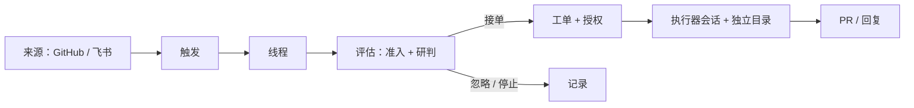

# SuperAgent 实践：从一句话需求到可评审的 PR

> 本文基于本仓库的几次真实任务整理，记录把一个主动式编码智能体接入日常仓库之后，工作方式发生了什么变化，以及哪里仍然需要人。

## 从一个问题开始

大多数编码智能体长在聊天窗口里：人描述任务，它写代码，人复制、粘贴、跑测试，再描述下一个问题。它提升的是「写」的速度，但每一步仍要人推动，成果也留在会话里。

SuperAgent 换了一个位置：它按仓库部署，有自己的账号、会话和目录；输入不是「下一步做什么」，而是「谁在什么时候、以什么方式提出了什么请求」。它把请求变成工单，在独立环境里完成调研、实现与验证，最后回到原对话交付一个可评审的 Pull Request。

一句话概括它的设计原则：**用尽量少的人类注意力，换尽量多的价值。**

「少」不是「不」。后面会看到，人仍然出现在三个地方：定方向、拍板、评审。

## 一条链路：来源 → 触发 → 评估 → 工单 → 交付

几个关键角色：

- **来源**：GitHub 的 Issue、Pull Request、评论与 CI，或飞书的群聊、私聊与话题。来源决定哪些消息算事件，并丢弃机器人自己的消息与监听范围之外的事件。
- **评估**：分两层。准入按允许名单与准入表做确定性判断——这个人能不能在这个渠道提需求、请求是否明确；研判则是模型结合线程上下文、已有工单和仓库做出的判断。两层都通过才接单，接单时生成工单，记录授权范围与请求强度（明确 / 推断）。
- **工单**：一次授权工作的单位。它有自己的目录（通常用 `git worktree` 检出）、自己的执行器会话和订阅的线程；工单之间互不干扰。
- **执行器**：读代码、改代码、跑检查、提 PR、跟进评审；需要人拍板时停下，而不是硬做。
- **交付**：结果回到请求发生的对话。成功时交付 PR；受阻时说清楚缺什么；没有结果就保持安静。

## 实践：本仓库上的三次任务

这个仓库是 SuperAgent 的试验场，几次文档改动都是通过它完成的：

| 任务 | 请求内容 | 产出 | 人的动作 |
| --- | --- | --- | --- |
| 改标题 | 把 README 标题改成「SuperAgent 试验场」 | [PR #1](https://github.com/liuhe37186/he-superagent-sandbox/pull/1) | 发一句话，评审后合并 |
| 补文档 | 补充 README，介绍主要功能 | [PR #2](https://github.com/liuhe37186/he-superagent-sandbox/pull/2) | 发一句话，评审后合并 |
| 写文章 | 写一篇 SuperAgent 实践文章，放到项目里 | 本文（本 PR） | 发一句话，评审后合并 |

三次任务的共同点：人只给了目标，没有给实现步骤；执行器自己读仓库、定结构、写内容、自查、提交。区别在于「评估」的工作量——改标题几乎没有歧义，补文档和写文章则需要先理解仓库的定位、已有内容和读者。

其中 PR #2 值得一提：请求只是「补充 README，介绍主要功能」，执行器先读了原型仓库与现有 README，把散落的能力归并成「接入、工单、执行、订阅、面板」几组，再补了流程图和说明。这是「研判」该做的事——把模糊的意图落成符合仓库现状的结构，而不是按字面堆一段文字。

## 拆开一次任务

本文本身也是一张工单，所以这一节可以当作自述。

1. **触发与准入**：请求在接入的对话里明确点名了这个智能体，发送者属于团队允许提需求的人，因此是一个「明确请求」，直接进入评估。
2. **评估与立项**：评估读取请求、线程上下文、这个仓库的历史工单和当前策略，判断这是一件新工作，而不是对已有工单的补充；随后生成工单，记录授权范围（写一篇文章并放进仓库）和强度（明确）。
3. **准备目录**：在独立目录里用 `git worktree` 检出仓库、切出以工单命名的分支。此后对仓库的读写都发生在这个目录，不碰其他人的工作区。
4. **执行**：先看仓库里已有什么（README、历史 PR），再确认原型仓库的设计文档，然后决定文章结构、写正文、核对链接与事实、检查范围——不顺手改无关文件。
5. **交付**：提交 PR，并回到原对话给出一条短消息：PR 已就绪，可以评审。中间过程不刷屏。
6. **评审与收尾**：人看 PR、提意见或合并；PR 上的后续讨论会被工单订阅，作为上下文继续送达，不需要再次 @ 它。

## 几条经验

**1. 说清结果和边界，比写步骤有用。** 「把标题改成 X」比「打开 README，找到第一行……」更有效。智能体需要的是目标和约束，不是操作手册。

**2. 任务粒度决定评审成本。** 局部、可验证、单模块的改动最适合交给它；跨模块重构、需要产品判断的改动，应该由人先定方向。

**3. 内容型任务仍然需要人的品味。** 文章的结构、语气、取舍，执行器可以给出一版合理的初稿，但「这篇给谁看、想让人记住什么」最好由人说清楚。默认值可以合理，却不等于符合你的偏好。

**4. 安静是一种功能。** 只在结果可评审、需要人决策或确实做不了时说话，比每一步都汇报更省注意力。进度留在面板和 PR 里。

**5. 订阅把一次性任务变成持续协作。** PR 上的评审意见、后续追问都会回到同一个工单，不需要重新描述背景。

## 边界与代价

- **它仍是研究原型。** 不是官方产品，可能有缺陷，工程实践也未必一致；先小范围试用，再逐步放开。
- **主动性需要规则约束。** 允许名单、准入表、请求强度、并发上限，这些不是形式，而是防止「帮倒忙」的闸门。无人要求的工作应先以「只记录不执行」的方式观察。
- **它用团队的账号说话。** 评论、提交、PR 都带着真实身份，每条消息都消耗同事的注意力。操作者要为它发出去的内容负责。
- **该停的时候要停。** 需要设计决策、会破坏调用方预期、或多种方案反复失败的改动，应该停下来问一个具体问题，而不是硬做到底。
- **成本是真实的。** 模型调用、并发执行、后台长任务都要资源；把它用在值得的地方。

## 最小上手清单

1. 准备一个仓库和一个机器人账号，确定谁可以提需求。
2. 按 [SETUP.md](https://github.com/deepseek-ai/dsh-superagent-prototype/blob/main/SETUP.md) 让编码智能体带你完成部署。
3. 先只记录主动候选，观察一轮它「本来会做什么」，再决定是否放开。
4. 从改文案、补文档、修小 bug 这类任务开始。
5. 和团队约定：什么算明确请求、什么必须由人先拍板、结果由谁评审。

## 小结

SuperAgent 真正改变的不是「写代码的速度」，而是人介入的位置：从每一步的操作者，变成方向、判断和评审的提供者。它把「和智能体聊天」变成「给团队加一个会提 PR 的同事」——这个同事需要授权、需要边界，也需要有人为它说的话负责。

如果只用一句话记住它：**注意力是预算，不是燃料。**
