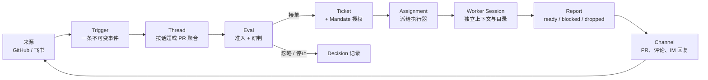

# 拆解 SuperAgent：从「会话里的助手」到「持续在线的协作者」

> 本文拆解的对象有两层：一层是 DeepSeek 产品部在[《Super-agent 设计探索：迈向更自主的 Agent 系统》](super-agent-design.md)中提出的系统设计；另一层是本仓库试验的 SuperAgent 原型。设计文章描述的是目标架构，原型实现的是其中一个可运行子集。文中会尽量区分两者：哪些是设计主张，哪些已经落成代码，哪些仍是开放问题。
>
> 下文把这类系统统称 **Super Agent**，把本仓库里运行的实例称为 **SuperAgent**。

## 1. 问题的起点：不是模型不够强，而是注意力不够用

以 Coding Agent 为代表的单任务智能体已经证明了一件事：只要任务边界足够清楚，模型可以自己读代码、改代码、跑测试，人只需要在开头给目标、在结尾做验收。

但把它放进真实的工作节奏后，新的瓶颈很快出现。一个人同时推进多项工作时，必须手动切换并记住每个 Session 的上下文；据设计文章的观察，人通常只能同时跟进 3 到 5 个活跃 Session。单任务的上限取决于模型能力，多任务的上限却取决于人的注意力。

这背后是三个很具体的限制：

- **串行阻塞。**经典 ReAct Loop 调用一次工具就停下来等结果，人在等待期间无法继续对话。
- **上下文混杂。**所有任务挤在一个 Session 里，中间细节互相污染；拆成多个 Session，又要人来搬运背景。
- **生命周期绑定。**Agent 跑在某台设备上，设备休眠、断网或进程退出，任务就停了。

所以 Super Agent 的关键并不是「换一个更大的模型」，而是**给模型换一套运行环境**。它要同时满足四个特征：

| 特征 | 含义 | 反面 |
| --- | --- | --- |
| 连续 | 人在 IM、GitHub、邮件等熟悉界面里始终面对同一个 Agent | 每换一个渠道就要重新交代背景 |
| 高效 | 多个任务并行推进，不必等上一个命令结束 | 一个长任务堵住整个对话 |
| 主动 | 持续观察环境事件，该出手时出手，不该说话时安静 | 等人类逐条下指令 |
| 持久 | 长期在线，异常后能恢复 | 设备离线即停摆 |

和常见的会话型 Agent 相比，差别可以浓缩成一张表：

| 维度 | 会话型 Agent | Super Agent |
| --- | --- | --- |
| 输入 | 人输入的提示词 | 环境事件，加上人的请求 |
| 工作单位 | 一个 Session | 一个持续的身份，加上 Thread 与 Ticket |
| 并发 | 单个 ReAct Loop 串行 | Router 调度，多 Worker 隔离执行 |
| 主动性 | 等人下指令 | 在规则授权下观察并推进 |
| 生命周期 | 绑定某台设备 | 状态持久，异常后恢复 |
| 交付 | 留在会话里 | 回到来源：PR、评论、IM 回复 |

实现这四个特征，靠的不是某一段提示词，而是一套系统。设计文章把它拆成五个模块；本仓库的原型则把这套思路落成了一个按单个 GitHub 仓库部署的编码智能体。

最核心的一步，是把 **Agent 的身份**和 **Session** 解耦：Session 仍是上下文管理的技术单位，但不再是用户要理解、要切换、要记忆的产品单位。用户面对的是一个持续的协作者，Session 变成它的实现细节。

## 2. 总览：四个特征，五个模块

五个模块与四个特征的对应关系大致如下：

| 模块 | 解决的问题 | 关键机制 | 原型中的对应 |
| --- | --- | --- | --- |
| 双层架构 | 连续与高效的张力 | 常驻 Router + 隔离的 Worker | 主 Session + 执行器 Session |
| 事件驱动 | 主动从哪来 | Trigger、Thread、订阅直通、两级过滤 | GitHub / 飞书 Source、Eval、Policy |
| 面向人的交互 | 连续与高效如何落到体验 | 异步 ReAct、多信道输出 | 后台任务、回复目的与字数约束 |
| 计算/状态/环境分离 | 持久在线 | 存算分离、端侧执行环境 | 持久化存储 + 每工单独立目录 |
| Watchdog | 长期运行的自愈 | 外部控制回路 | 健康检查、重试与恢复（部分实现） |

一条请求在系统里的完整路径，可以压缩成下面这张图：



这张图里有三个容易忽略的设计点：

1. **事件先落成 Thread，再进入评估。** 评估看到的不是孤零零的一句话，而是一段有顺序、有前因后果的对话。
2. **接单产生的是 Ticket 和 Mandate，不只是一个任务。** 前者管执行，后者管「凭什么做、能做到哪」。
3. **结果回到来源。** PR 回到 GitHub，回复回到 IM；Agent 不要求人换一个界面来收结果。

下面按模块拆开。

## 3. 双层架构：让「连续」和「并发」不再互相牺牲

### 3.1 一个根本的权衡

如果所有事件都交给同一个 Session 处理，上下文最连续，但受限于单个 ReAct Loop 的串行速度，吞吐低，多个任务的中间细节还会混在一起。

反过来，如果每个事件都新开一个 Session，并发最高，但任务之间缺少全局上下文，多个 Session 各自回复用户也会造成混乱。

双层架构的做法是把这两件事拆到两层：

- **Router 层**负责「维护全局连续性」：承接人类交互、汇总跨任务信息、做分派与协调。
- **Worker 层**负责「高并发执行」：上下文隔离，挂载完整工具，专注完成单一任务。

```mermaid
flowchart TB
  subgraph Router["Router 层（原型中的主 Session）"]
    R1["承接人类交互"]
    R2["全局记忆与序点"]
    R3["任务分派与跨任务协调"]
  end
  subgraph Workers["Worker 层（原型中的执行器 Session）"]
    W1["任务 A<br/>独立上下文"]
    W2["任务 B<br/>独立上下文"]
    W3["任务 C<br/>独立上下文"]
  end
  R3 --> W1
  R3 --> W2
  R3 --> W3
  W1 -. 汇报状态 .-> R1
  W2 -. 汇报状态 .-> R1
  W3 -. 汇报状态 .-> R1
```



### 3.2 Router：全局序点，但不亲自干活

Router 层是常驻的全局路由层，充当全局的**序点（Sequence Point）**、协调点和记忆。所有跨任务的信息与决策在这里汇总。

它最重要的约束是：**不直接执行具体任务**。设计文章甚至说，Router 可以不配备 Bash 工具。原因很直接：一旦 Router 开始跑命令、读大文件、做长任务，它就会被阻塞，整个系统的入口随之变慢。

这也解释了为什么 Router 可以用较轻量的模型：它做的是「判断这是不是新任务、该交给谁、要不要回复」，而不是「把任务做完」。

单个常驻 Router Session 看起来像瓶颈，但设计文章的实验给出了一个反直觉的结果：积压的事件会在下一次模型调用时合并成 batch。当需要决定的 Trigger 从每分钟约 1 条升到约 40 条时，平均 batch 从 1.0 升到 2.8，单次请求耗时只从 2.5 秒升到 3.9 秒，单个决定分摊的推理时间反而从 6.4 秒降到 1.6 秒。

这背后的原因是 Prefill 阶段的并行计算：长输入、短输出的 Router，合并处理多条 Trigger 的边际成本很低。所以在团队规模内，不必过早把 Router 水平切分——切得越细，全局记忆越碎。

### 3.3 Worker：隔离执行，统一汇报

Worker 层由具体执行的 Session 组成。每个 Worker 有独立的上下文、完整的执行工具，专注一个任务。它通常配置能力最强的模型，因为结果质量由它决定。

Worker 不直接经营来源对话。它的过程性输出留在 Session 里，关键状态和结果汇报给 Router，对来源对话的回复由 Router 统一发出；GitHub 上的 PR、评审回复等工作产物仍由执行器直接写入。这样既保住了并发，又避免多个 Session 同时向用户说话。

多个 Worker 之间通常也不直接通信。它们的冲突往往发生在同一个 PR、同一个文件这类共享工作环境里；只要都订阅了对应的 Thread，就能收到相同的事件，有机会自己发现并解决冲突。少数跨任务协同由 Router 中转。

这和常见的 Agent Team 不同。Agent Team 的主会话通常要深入任务细节、拆子任务、高频协调成员，自身推理负载很重；Super Agent 的 Router 只处理任务之间的高层关联，不介入单任务内部。前者像「带项目的技术负责人」，后者更像「前台 + 调度台」。

### 3.4 原型怎么落这两层

在 `dsh-superagent-prototype` 里，这两层对应得很直接：

- **主 Session**：路由与评估。它只有 14 个应用工具，主要用来读上下文、做决定、回复、配置；提示词明确要求它不要读代码、不要解决 Worker 的阻塞。它还带一个 `noWait` 保护：拒绝 `sleep`、拒绝超过 30 秒的 shell 超时、拒绝超过 5 秒的 job 等待，避免它卡住入口。
- **执行器 Session**：每张工单一个，命名 `worker-<ticket id>`，配一个独立目录（通常用 `git worktree` 检出）。它有 6 个应用工具，外加文件、搜索、shell、后台任务、skill、subagent 等完整工作工具。
- **并发控制**：工单持有 worker slot；人的消息可以额外占用一个槽位，保证人不会被新任务堵住。
- **分工不是靠提示词「希望」模型自觉**。Worker 不装配 `ask_user_question`、`present` 这类面向人的工具；主 Session 也不被允许替 Worker 做技术决策。系统用工具面和状态机把职责固定下来。

设计文章里有一组对照实验很能说明问题：在「单 Session + Subagent 工具」的方案里，中性提示下模型 5 次实验一次都没调用 Subagent，所有工作都在主 Session 里被新消息打断，p95 达到 29.5 分钟；改成明确提示「优先委派」后，5 次里有 4 次委派，但仍有 1 次判断「工作很小」而自己执行，形成长尾。双层架构则把这种「分不分工」的判断从模型手里拿走，交给系统。

最终，Super Agent 的任务完成时间 p50 / p95 为 12.4 / 15.7 分钟：p95 明显短于单 Session 方案，波动也更小。代价是更高的 token 消耗——这一点后面再算账。

## 4. 事件驱动：主动性来自「环境推着走」

### 4.1 Trigger、Thread 与订阅

在 Super Agent 里，驱动 Agent 的主要输入不再是人在输入框里敲的提示词，而是环境中的半结构化事件：群聊消息、PR 评论、CI 结果、邮件、日程提醒。这些事件被称为 **Trigger**。

Trigger 是不可变的，带来源自己的元数据（谁发的、在哪个渠道、是否 @ 了 Agent）。同一个 Trigger 被接受两次，只会产生一张工单——这是幂等性的基础。

同一个 PR、同一个 IM 话题、同一封邮件串下的连续事件，构成一条 **Thread**。Thread 是评估的上下文单位，也是订阅的挂载点：Router 根据 Thread 的初始事件创建 Worker 后，Worker 直接订阅这条 Thread，后续事件由程序直通给它，不再经过 Router。

这就是事件路由的 **Fast Path / Slow Path**：

- **已订阅（Fast Path）**：同一 Thread 的后续事件直接送到已订阅的 Worker。
- **未订阅（Slow Path）**：Router 仍能看到所有事件，但只负责判断和分派尚未被订阅的新事件。

订阅是多对多的：一个 Worker 可以订阅多条相关 Thread，一条 Thread 也可以被多个 Worker 订阅。当多个 Worker 在同一个 PR 或讨论里发生交集，新事件会同时到达它们，这比让 Worker 之间点对点通信更简单，也更适合松耦合的并发。

### 4.2 两级过滤：代码做快路径，模型做慢路径

接入真实环境后，事件流呈现「高噪音、低触发率」：绝大多数消息不需要 Agent 介入。如果每条都调用大模型判断，延迟和成本都难以承受。

所以事件进入系统后先过一道**程序层策略（Fast Path）**：来源、群组范围、用户白名单、机器人列表、是否明确请求——这些确定性条件用代码判断即可。只有通过准入的候选，才交给**语义层策略（Slow Path）**，由模型结合提示词策略和上下文判断是否需要行动。

这个划分不只是性能优化，它还决定了系统的可治理性：

- 代码层是硬边界。谁能发起工作、哪些来源被监听、哪些机器人只能产生候选，这些不随提示词变化。
- 模型层是软扩展。团队可以用自然语言写规则、加策略，不必每次改代码。

在原型里，这一层被具体化为 **Gate + Assessment**：

- **Gate**：允许名单、是否 @、准入表、机器人列表，决定一条消息是「明确请求」「推断候选」还是「不接纳」。
- **Assessment**：模型对每个启用的规则逐条判断，决定接单、停止还是忽略；推断候选只有在 `auto` 模式下才可能被接单。
- **Accept mode**：`off` / `observe` / `auto`。默认 `observe`——模型可以评估，但只记录「本来会接」，不真的行动。这是给主动性装的第一道刹车。

设计文章把这种结构称为「程序策略 + 大模型」的两级过滤。它的精妙之处在于：**把「不该做什么」交给确定性代码，把「值不值得做」交给模型**。

### 4.3 上下文：Inline & Spill 与链式召回

事件进入 Session 后，下一个问题是：该往上下文窗口里放多少信息？

放多了，挤占窗口、稀释注意力；放少了，模型要反复调用工具读取，浪费步数。设计文章把这称为「浪费上下文窗口，就是浪费模型的智能」。

它借用了两个操作：

- **Inline**：把近期很可能用到的信息直接放进上下文，省掉工具往返。
- **Spill**：把超出预算或低频使用的完整信息留在窗口外，只保留引用或摘要，需要时再读。

再配合局部性（Locality）原则，注入可以逐步优化：先给对象 ID 和摘要；再内联紧密关联的对象 ID、前后相邻的消息、评论所在的讨论；超出上限就截断并保留续读入口。

当这套做法一致地应用到 Trigger、Thread、Worker Session 等所有对象上，就形成了**链式召回（Chain of Recall）**：每个对象都内联下一跳关联对象的 ID，模型可以从当前事件出发，沿引用图逐跳展开上下文。这缓解了 Router 在长程运行中「记不住旧任务」的问题。

原型里的上下文是严格有界的：评估时 Trigger 正文最多 4,000 字符，Thread 窗口取前 5 条和 Trigger 两侧各 5 条，相关工单最多 8 张；读取资源一页默认 4,000 个 UTF-16 单元、最多 8,000。超出部分不是丢失，而是变成可继续读取的指针。

### 4.4 投机执行：在不确定时先做一点

设计文章还引入了一个来自 CPU 的概念：**投机执行（Speculative Execution）**。Agent 可以在还不确定结果是否会被采用时，根据环境信号在后台先尝试；有价值就交付，没价值就丢弃。

例如群里有人反馈问题，Agent 先在后台复现、找修复方案，确认问题且方案简单时才把 PR 交付出来，否则全程安静。它用额外算力换人的等待时间。

这和「主动」不是一回事。主动是「该不该出手」，投机是「出手前先准备好」。两者结合，才能做到「人还没决定，Agent 已经把选项摆好了」。

当然，投机执行也会浪费算力，甚至制造噪音。原型的做法是用规则和 `observe` 模式先观察：哪些主动行为真的有用，再决定是否放开。

## 5. 从事件到工单：把「自主」关进授权里

这是原型比设计文章多出来的一大块，也是我认为最值得拆的部分。

很多 Agent 系统只有「任务」：收到请求，开干，干完回复。Super Agent 多了一层 **Ticket（工单）**。工单不只是任务的容器，它还是**授权单位**：

- 它记录这次工作「凭什么可以做」——Mandate。
- 它记录「做到哪算够」——scope。
- 它记录「谁在什么渠道、以什么强度提出的」——来源与强度。
- 它把执行、报告、订阅、结束串成一条可审计的生命周期。

### 5.1 一条完整的链路

```text
Trigger → Eval → Decision → Ticket + Mandate → Assignment → Report → 结束
```

- **Eval**：对一批 Trigger 做判断，分准入（Gate）和研判（Assessment）两层。
- **Decision**：接单、停止、忽略，或评估未完成。
- **Mandate**：接单时授予的授权，包含策略版本、范围、强度（明确 / 推断）、匹配到的规则、请求者在来源上的身份。
- **Assignment**：把工单绑定到一个执行器实例。一张工单可以先后有多个 Assignment。
- **Report**：执行器汇报进展、等待、就绪、受阻、失败或无需处理。

Mandate 是**不可变**的。想扩大范围，只能开新工单；工单结束也不会让 Mandate 消失——只有人明确停止、或策略不再成立，授权才会被收回。策略变更不会立刻撤销正在执行的工单，而是把变更告知受影响的工单；工单恢复前会按当前策略重新校验。

这套设计把两个容易混淆的东西分开了：

- **上下文**：订阅让后续消息自动到达工单，不需要再 @ 一次。
- **授权**：订阅只提供上下文，不授予新权限；工单始终受自己的 Mandate 约束。

所以一条后续消息可以「到达」工单，但不等于工单可以「据此扩大工作范围」。执行器要么在范围内处理，要么把消息交回，让主 Session 重新评估。

### 5.2 强度：明确请求与推断候选

原型把请求强度分成两档：

| 强度 | 典型场景 | 能否直接接单 |
| --- | --- | --- |
| explicit（明确） | 允许名单里的人 @ 了 Agent，或在已有工单的 Thread 里追问 | 可以，任何 accept mode 下都生效 |
| inferred（推断） | 未列名的人追问、机器人消息、准入表配置为候选 | 只有 `auto` 模式且命中规则时才可以 |

`observe` 模式下，推断候选照样评估，但结果只记录为「would accept」，不产生工单。团队可以先看一轮「它本来会做什么」，再决定是否切到 `auto`。

这是我认为整个系统里最重要的产品决策之一：**主动性默认是关的，而且可以被观察。** 它把「要不要让 Agent 自己找活干」从一个信仰问题，变成了一个可以看数据、逐步放开的运营问题。

### 5.3 工单的阶段

工单不跟随执行器的内部状态，而是定义自己的阶段：

| 阶段 | 条件 | 面板语言 |
| --- | --- | --- |
| person / delivery | 消息投递失败，正在重试 | 输入未送达 |
| person / answer | 有一个等待人回答的问题 | 等待回答 |
| person / review | 最新报告是 ready | 等待评审 |
| person / blocked / failed | 最新报告是 blocked 或 failed，且之后没有人发言 | 受阻 / 失败 |
| working / queued | 没有 Assignment，或 Assignment 待启动 | 排队中 |
| idle | 最新报告是 waiting，或 Assignment 已结束 | 等待新事件 |
| working | 其他情况 | 执行中 |

这个阶段表的价值在于：**它回答的是「现在在等谁」，而不是「内部状态码是什么」。** 面板上的一行字，直接告诉人要不要出手。

### 5.4 结束、订阅与恢复

工单的结束条件也很克制：

- 报告 `ready` 且没有 PR：完成。
- 报告 `dropped`：无需处理，安静结束；之后有人在 Thread 里说话可以恢复。
- 它打开的 PR 全部合并或关闭：按最后一次关闭的结果结束。
- 人明确停止：结束，且不再接收任何消息。

结束后的工单保留订阅。一个人在它的 Thread 里继续说话，可以在同一 Mandate 下恢复，不需要重新评估；但机器人消息和 CI 不会唤醒它。被明确停止的工单则彻底安静，新的工作必须重新走一次接单。

这套机制让「一次任务」变成了「一段可以持续协作的关系」，同时又保留了人的停止权。

### 5.5 走一遍：一条请求的旅程

以本仓库的一次文档任务为例：

1. 有人在飞书里 @ 它，贴上一个链接，说「放到仓库里，再写一篇拆解」。
2. Source 把消息变成 Trigger；Gate 判断发送者在允许名单里、消息明确点名，强度为 explicit。
3. 主 Session 接单，生成 Ticket 和 Mandate：范围是「把文章放进仓库并写拆解」，策略版本记录在案。
4. 执行器在独立 worktree 里读仓库、定结构、写文件、自查，再把 PR 链接和状态报回来。
5. 主 Session 把「PR 已就绪」送回原来的飞书对话；工单进入「等待评审」阶段，并订阅这个 PR。
6. 人在 PR 上提意见或合并；后续评论自动到达工单，不需要再 @ 一次。

## 6. 面向人的交互：安静是一种功能

### 6.1 全双工：后台在跑，前台还能说话

经典 ReAct Loop 的问题前面说过：一次工具调用会阻塞整个对话。设计文章的解法是把耗时的命令和子任务改成异步的 `start()` / `stop()`：调用后立即返回「已启动」，后台完成后把结果作为新事件投递回会话；模型也可以根据上下文主动停止跑得太久的命令。

原型没有完全照搬这套接口，而是用后台任务达到了类似效果：

- 前台 shell 命令超过 5 秒就转到后台，Worker 可以在下一步接收新消息。
- 一轮结束时如果还有后台任务，工单继续持有 worker slot，不会被误报为「等待」。
- 后台任务最多再跑 30 分钟，超时会被杀掉并汇报；交给人的工单则立即释放槽位。
- 人可以直接在执行器 Session 里继续说话，不会被排队挡住；并发满时，人的消息还能多占一个槽位。

这类细节看起来像工程实现，实际上决定了体验：**人不需要等 Agent 跑完才能改主意。**

### 6.2 多信道：同一件事，不同写法

不同渠道的信息密度和交互习惯不同。把终端里的长篇推理直接搬进群聊，是信息灾难。

Super Agent 的做法是：把冗长的推理和过程性输出留在 Worker 内部，对外对话由 Router 统一发出，并按渠道定制规范：

- **IM**：低打扰、轻量。只在需要决策或验收时说话，只问直接的问题，给简短的结论；单条回复硬上限 100 词。
- **GitHub / 邮件 / 文档**：结构化、高密度。PR 要写清问题背景、改动说明和验证结果；评审意见要逐条回应。

原型还把「回复」做成了有目的的结构化动作：确认、回答、结果、请求注意。每种目的对应不同的触发条件和长度限制。提问必须走结构化的 `human_action`，一次只问一个具体问题；问题会回到提出请求的那个对话里——如果由某条具体消息引出，就回到那条消息下面——而不是埋在一份长报告里。

### 6.3 什么叫「完成」

这一条值得单独说：**开了一个 PR，不等于完成。**

原型的报告状态里，`ready` 意味着实现已自查、相关检查已通过、结果可供人评审；`blocked` 意味着缺一个具体的东西；`failed` 意味着确实做不了；`dropped` 意味着没有需要人处理的事。草稿必须标明未完成，UI 改动没有真实的前后对比截图就不能说 ready。

这听起来像流程要求，其实是注意力经济的一部分：如果 Agent 把「半成品」当「完成」报出来，人就要花时间分辨，省下来的注意力又赔回去了。

## 7. 持久与自愈：让 Agent 活过一台机器

设计文章的持久化分两步：

1. **计算与状态分离**：把推进 Agent Loop 的计算做成无状态容器，把 Session 等状态放进数据库。容器可以重启、替换、水平扩展，连续性由存储保证。
2. **计算与执行环境分离**：真实的工作环境（未提交的修改、私有凭据、内网服务、特定工具链）很难复制到云端，所以让执行环境留在原地，端侧只放一个不保存会话状态的轻量 daemon，Agent 按需通过它执行命令、读取上下文。

这套思路支持 **BYOM（Bring Your Own Machine）**：Agent 在云端持续在线，需要时接入用户的开发机、托管机器或按需创建的沙箱。它甚至能处理间歇在线的设备——设备重新上线后，再触发需要它的任务。

再往外一层是 **Watchdog**：一个独立的、由定时消息驱动的 Agent Session，构成主系统之外的控制回路。它不仅看进程是否存活，还看 Worker 是否有实质进展、方向是否偏离目标；发现问题就介入，遇到外部故障就持续复查。

原型实现的是这套设计的一个务实子集：

- 状态落在本地 SQLite；事件、工单、决策、订阅、Assignment 都可恢复。
- 副作用走持久化队列：先在事务里记录「要做什么」，提交后再执行；失败按指数退避重试。
- 回复有回执：消息先入 Outbox，发送成功才结算；同一工单发往同一会话的消息保持顺序。
- 每张工单一个目录，重启后执行器会先检查目录、git 历史和 GitHub，再决定是否重复外部动作。
- 来源有读取位置，重启不会重放旧事件；投递过的消息有「已读」记录，避免重复处理。

它没有实现云端 daemon、跨设备执行环境和独立的 Watchdog Session——原型是跑在 DeepSeek Harness 里的一个插件，生命周期仍绑定在本机进程上。设计文章里那些部分，是方向，不是现状。

但即使在这个子集里，「先记录、再执行」的原则也已经很重要：一个会对外发评论、开 PR、改代码的系统，必须能回答「这条消息发没发出去」「这个工单做到哪了」「重启后要不要重来」。这不是工程洁癖，而是 Agent 进入真实工作流的前提。

## 8. 代价与边界：没有免费的自主

### 8.1 Token 账

设计文章的消融实验给了一组很诚实的数字：

| 方案 | 任务完成 p50 / p95（分钟） | 单次实验读缓存 token |
| --- | --- | --- |
| Super Agent | 12.4 / 15.7 | 2,323 万 |
| Super Agent，去掉直通 | 12.6 / 15.5 | 3,177 万 |
| 单 Session + Subagent，中性提示 | 20.4 / 29.5 | 605 万 |
| 单 Session + Subagent，提示优先委派 | 13.8 / 29.0 | 1,082 万 |

Super Agent 相对中性提示的单 Session 方案，用大约 4 倍的 token，换来了更短、更稳定的完成时间。去掉订阅直通后，完成时间几乎不变，但 Router 的决策次数增加约 30%，token 增加约 37%——这说明直通省下的是 Router 的重复推理，而不是任务本身的开销。

所以「要不要上 Super Agent」不是一个纯技术问题，而是一个成本结构问题：如果人的等待和切换成本高于 token 成本，这笔账就划算；如果任务本身很轻、很独立，单 Session 可能更经济。

### 8.2 注意力账

比 token 更贵的是人的注意力。Agent 每发一条消息、每开一个 PR、每问一个问题，都在消耗同事的时间。

原型的很多设计都是在省这笔账：默认安静、进度只留在面板和 PR、一次只问一个问题、不在未就绪时宣布结果、主动工作默认只观察不执行。原型的理念文档甚至把「不要用它生产数量」写成了操作者的责任：批量 PR、广播消息、无意义的忙碌，对团队的伤害大于收益。

### 8.3 安全账

事件驱动让 Agent 接触更多不可信输入，也让提示词注入的风险变大。设计文章列了几个关键问题：

- 云端 Agent Loop 一旦被攻破，它连接的所有端侧设备都面临风险。
- 即使云端没被攻破，凭据一旦进入模型上下文，也可能在正常执行中泄露。
- 需要设计让 Agent「使用凭据但不接触凭据本身」的机制。

原型的边界也要说清楚：`blocked commands` 只是按名字拦截，不是安全沙箱；执行器以操作者的 OS 用户运行，仍可以用绝对路径执行程序。它适合可信团队内部使用，不适合直接暴露给不可信用户。

### 8.4 还没解决的问题

设计文章自己列了四类开放问题，值得原样记住：

- **双层架构怎么扩展**：Router 何时需要水平切分，Worker 之间何时需要直接通信，长程记忆怎么处理。
- **脱离 Session 后怎么协作**：用户界面上的「会话」不再对应底层 Session，项目管理与中途干预怎么做。
- **上下文边界与 A2A**：组织内多个隔离实例之间如何安全协作。
- **安全与隐私**：前面说的凭据、跨设备信任、提示词注入。

这些问题没有标准答案，也决定了 Super Agent 目前更像「可运行的研究原型」，而不是开箱即用的产品。

## 9. 如果要自己做一个：最小可复刻清单

把上面的设计压缩成可执行的顺序，大概是这八件事：

| # | 能力 | 最小实现 | 为什么不能省 |
| --- | --- | --- | --- |
| 1 | 事件接入 | 一个来源适配器 + 幂等事件表 + Thread key | 没有稳定的事件流，后面都是空中楼阁 |
| 2 | 确定性准入 | 允许名单 + 是否 @ + 来源范围 | 先挡住不该进来的，再谈模型判断 |
| 3 | 授权单元 | Ticket + Mandate + 策略版本 | 让「凭什么做」可审计、可收回 |
| 4 | 隔离执行 | 每工单一个 Session + 一个目录 | 并发不串味，失败可恢复 |
| 5 | 订阅与追问 | Thread ↔ Ticket 多对多 + 后续消息直通 | 一次任务才能变成持续协作 |
| 6 | 持久副作用 | 队列 + Outbox + 重试 + 重启恢复 | 对外动作不能靠内存里的承诺 |
| 7 | 面向人的协议 | 确认、提问、结果、受阻四种消息 | 决定人要不要出手、什么时候出手 |
| 8 | 观察与放开 | observe 模式 + 面板 + 记录 | 先看它本来会做什么，再决定放权 |

顺序也很重要：**先做「记录」，再做「执行」；先做单任务闭环，再做多任务并发；先做确定性边界，再放模型判断。** 一上来就追求「多 Agent 自治」，很容易得到一个既不可控、也不可靠的系统。

## 10. 结语：模型是 CPU，系统才是产品

回头看，Super Agent 没有发明什么全新的理论。双层架构、事件驱动、批处理、缓存、投机执行、存算分离、看门狗——这些都是计算机系统里的老思想。它做的事情，是把这些思想认真地应用到「Agent 如何工作」这件事上。

它真正改变的，是人的位置：

- 从「每一步的操作者」，变成「方向、判断和验收的提供者」。
- 从「记住每个 Session 的上下文」，变成「在结果出现时做评审」。
- 从「催 Agent 干活」，变成「决定哪些活值得让 Agent 干」。

这也是为什么我一直觉得，「注意力是预算，不是燃料」这句话比任何架构图都更能概括 Super Agent。模型会越来越强，工具会越来越多，但一个人一天能做的判断是有限的。好的系统不是让 Agent 说更多话，而是让它在正确的时候说正确的一句。

如果只用一句话记住这套设计：**把 Agent 从会话里拿出来，放进组织的工作流里；然后，用授权、边界和安静，守住人的注意力。**
